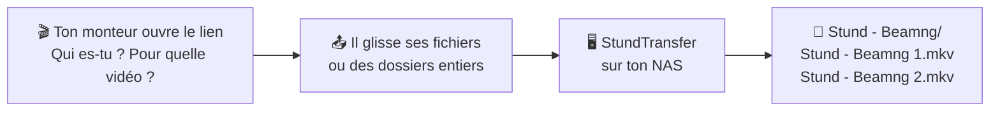

# 📦 StundTransfer

**Le dépôt de rushs vidéo, directement sur ton NAS.**

Un lien, un nom, une vidéo : les fichiers arrivent rangés dans le bon dossier. 
Pas de compte à créer, pas de limite de taille, pas de cloud entre les deux.

## Comment ça marche

1. **La personne dit qui elle est et pour quelle vidéo**, puis glisse ses fichiers ou des dossiers entiers.
2. **L'envoi part à pleine vitesse**, en plusieurs morceaux à la fois. Si la connexion coupe ou si la page se recharge, ça reprend où ça s'était arrêté.
3. **Tout arrive rangé** dans `Dossier de réception/Nom - Vidéo/`, un dossier par dépôt. Aucun fichier n'est jamais écrasé.

## Ce qu'il y a dedans

- 🙅 **Aucun compte pour déposer** : on arrive directement sur la page d'envoi, sans inscription ni page de connexion.
- 🚀 **Pleine vitesse** : morceaux de 20 Mo envoyés en parallèle, réessais automatiques, reprise après une coupure.
- 📁 **Rangement automatique** : un dossier `Nom - Vidéo` par dépôt (`(2)`, `(3)`… si le nom existe déjà), avec l'arborescence des dossiers d'origine.
- ✏️ **Renommage avant l'envoi** : un crayon à côté de chaque fichier. Les fichiers d'OBS ou d'appareil photo (`2026-07-22 14-32-10.mkv`, `IMG_1234.MOV`) deviennent automatiquement `Stund - Beamng 1.mkv`, `2`, `3`…
- 🛡️ **Espace admin** : tous les dépôts reçus, le choix du dossier de réception et des liens de partage pour envoyer des fichiers à quelqu'un.
- 🎨 **À ton image** : nom, logo, couleurs, thème et réglages se changent depuis l'interface, sans toucher au code.
- 🇫🇷 **En français**, avec l'anglais disponible.

## Installation

Pour un NAS **Synology à processeur Intel ou AMD** (gamme « + » : DS224+, DS225+, DS423+…) avec **Container Manager**.

👉 **[Guide d'installation pas à pas](https://github.com/StundZow/StundTransfer/blob/stundtransfer/INSTALLATION.md)** : sans code, environ 45 minutes, de l'utilisateur DSM dédié jusqu'à l'accès depuis internet.

Le guide technique complet (réglages, droits, revenir à une ancienne version) est dans [STUNDTRANSFER.md](https://github.com/StundZow/StundTransfer/blob/stundtransfer/STUNDTRANSFER.md).

## Mettre à jour

**Administration → Mettre à jour → Mettre à jour maintenant** : la nouvelle version s'installe en un clic (voir le guide d'installation, étape 6).

## Basé sur Pingvin Share X

StundTransfer est une fork de [Pingvin Share X](https://github.com/smp46/pingvin-share-x) (smp46), elle-même issue de [Pingvin Share](https://github.com/stonith404/pingvin-share) (Elias Schneider). Merci à eux 🐧

- Le code de StundTransfer est sur la branche [`stundtransfer`](https://github.com/StundZow/StundTransfer/tree/stundtransfer). La branche `main` suit le projet d'origine.
- Le partage de fichiers d'origine reste disponible pour les admins.
- Licence [BSD 2-Clause](https://github.com/StundZow/StundTransfer/blob/stundtransfer/LICENSE), comme le projet d'origine.
